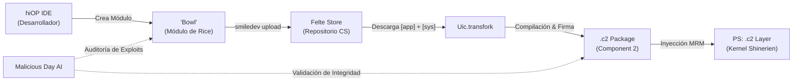

# Arquitectura de Hardware, Memoria NAND y Protocolo MRM — Coki Studios
> **Documento Oficial de Especificación Técnica — 10 de Noviembre de 2026**  
> **Basado en los planos originales de ingeniería de Coki Studios & Shine OS**  
> **Ecosistema:** Shine OS (SUI) • UI Connect (UIC) • Looping Engine (Arch 3.0A) • Loop OoS • Felte Store

---

## 1. Memoria CS NAND para UIs (`QLC Mem`) — `NS` vs `PS`

La memoria interna principal de los dispositivos Shine OS se estructura a nivel de hardware y controlador en dos particiones estancas con control criptográfico de acceso:

```
┌──────────────────────────────────────────────────────────────────────────────┐
│                    CS NAND for UIs (QLC Mem Architecture)                    │
├──────────────────────────────────────────────────────┬───────────────────────┤
│            NS = Normal Storage (Userdata)            │  PS = Protected Store │
│  • Espacio libre para el usuario                     │  • OS & Shinerien Krnl│
│  • Fotos, música, descargas y aplicaciones estándar  │  • Rice layer         │
│  • Caché del sistema y medios multimedia             │  • .c2 layer          │
│  • Accesible directamente en modo de ejecución SUI   │  • NEC pair           │
│                                                      │  • Priv data (Felte)  │
│                                                      │  • CSMS Hardware Keys │
└──────────────────────────────────────────────────────┴───────────────────────┘
```

### Regla Fundamental de Seguridad
> **"The only way to touch PS (Protected Storage) is with UIC and the Phone is in MRM (Multi Recovery Mode)."**

Bajo condiciones normales de ejecución (`Normal SUI`), la partición `PS` está bloqueada a nivel de lectura/escritura por el micro-kernel de seguridad del chip **ESC X1**. Ningún proceso de usuario o app de terceros puede modificar el `Rice layer`, los módulos `.c2` del sistema ni el emparejamiento `NEC` fuera de una sesión autenticada con UI Connect (UIC).

---

## 2. Protocolo MRM (Multi Recovery Mode) en Shine OS

### 2.1 Secuencia Física de Activación
Para colocar cualquier celular Shine (X1, Xa1, f1 Fold, Nomad 1, A1, Vintage) en modo `MRM`:
1. Deslizar la barra superior hacia abajo para abrir **Quick Access**.
2. Presionar el botón físico de **Power**.
3. En el menú de energía, mantener pulsado **Restart** y presionar simultáneamente los botones **Volumen Arriba (`Vol+`)** y **Volumen Abajo (`Vol-`)**.
4. El dispositivo reinicia directamente en el cargador seguro `MRM Screen`.

### 2.2 Estados Visuales en la Pantalla del Celular (`MRM Screen`)
| Estado MRM | Representación en Pantalla | Significado Operativo |
| :--- | :--- | :--- |
| **`Disconnect`** | Monitor `[PC] !` con cable suelto y rayo `⚡` | El celular está en `MRM` pero no detecta enlace USB/ADB con UI Connect en la PC. |
| **`Uic idle`** | Monitor con logo `CS • UIC` y 3 puntos `• • •` | Enlace USB establecido y autenticado. Listo para recibir instrucciones de UIC. |
| **`Working`** | Engranaje activo + **`NO Disconnect / Not power off`** | Transfiriendo o inyectando en `PS`. Prohibido desconectar el cable o apagar. |

### 2.3 Operaciones de UIC sobre la Partición `PS`
* 🔄 **`Restore SUI`**: Restaura la imagen completa de fábrica de Shine UI en `PS`.
* 🩹 **`Repair SUI`**: Repara dependencias corruptas del kernel `Shinerien` y del `Rice layer`.
* ⚠️ **`Inject .c2 on PS (Dangerous)`**: Inyecta módulos declarativos Component 2 (`.c2`) directamente en la partición protegida del sistema.
* 💿 **`Change OS`**: Conmuta la imagen base entre ramas del sistema (e.g. SUI Stable, Looping OoS Edition).

### 2.4 Trilogía de Seguridad *"Be careful"* (Página 8)
Para autorizar cualquier escritura o inyección sobre `PS`, UIC exige la validación concurrente de 3 requisitos:
1. `Enable MRM Protect on Settings`: Interruptor de protección activa habilitado en los ajustes de seguridad del teléfono.
2. `Add Trust PC on Settings`: Clave pública de la computadora registrada en la lista de confianza del dispositivo.
3. `Sign .c2 on UIC`: Paquete `.c2` firmado criptográficamente con algoritmo SHA-256 e integridad verificada.

---

## 3. Arquitectura de Software: `Rice`, `"Bowls"`, Kernel `Shinerien` y `.c2`



* **`Rice by Shine!`**: Es la base fundacional del entorno de ejecución móvil.
* **`"Bowls"`**: Son los módulos funcionales construidos sobre la base de `Rice` creados en el IDE `hiOP`.
* **`smiledev`**: Consola oficial de desarrollo de Coki Studios para empaquetar y publicar *bowls* y apps hacia `Felte`.
* **`Uic.transfork`**: Motor de transpilación dentro de UI Connect que transforma la combinación de módulos `[app]` y módulos de sistema `[sys]` en paquetes modulares ejecutables **`.c2` (`Component 2`)**.
* **`Kernel Shinerien`**: Sub-kernel acelerador diseñado específicamente para optimizar la carga ultrarrápida de archivos de recursos `Rice` y módulos `.c2`.
* **`Malicious Day`**: Agente de inteligencia artificial centinela que audita el código de los *bowls* y módulos `Rice` para detectar y neutralizar vulnerabilidades o exploits antes de su despliegue.

---

## 4. Arquitectura de Silicio Coki Studios (Chips CS)

### 4.1 `ESC` / `ESC X1` (Elevate Security Chip)
* **Función**: Keystore respaldado por hardware para todo el ecosistema Coki Studios.
* **Biometría `Lookit`**: Almacena y procesa huellas dactilares y reconocimiento facial sin exponer datos sensibles a la CPU principal.
* **Estructura Interna del Die**:
  * `minii OS`: Micro-kernel de seguridad aislado de latencia sub-milisegundo.
  * `Rotate 1`: Co-procesador en rombo/diamante para transformaciones geométricas y cálculo de sensores Hall.
  * `Keystores R1m`: Bóveda de almacenamiento de claves privadas y verificación de firmas `.c2`.

### 4.2 `NEX1` (`NEC` / `NFC.E 286`) — *NFC Enhanced Communication*
* **Integración Todo-en-Uno**: Unifica en un único chip el subsistema **`W1 WiFi`**, el controlador **`NFC RW`** de lectura/escritura y el chip **`Bluetooth`**.
* **Antena Espiral Compartida**: Bobina de RF que sirve simultáneamente para telecomunicación `Advice NEC` y para el sensor de orientación `Rotate 1`.
* **`brightsmile chip 1` (`brs1`)**: Núcleo de procesamiento de señal que coordina la memoria `Mem Advise NEC`, la memoria `Rotate 1 Mem` y el circuito inferior `Battery Coil` para recarga inalámbrica y acoplamiento inductivo.

### 4.3 `XR1` (eXcape Reality Chip 1 — 10 Cores)
* Diseñado para computación espacial, realidad aumentada y renderizado en alta tasa de refresco:
  * **8 `Lightcores`**: Agrupados en 2 filas de 4 núcleos de alta eficiencia energética.
  * **2 `PowerCores`**: Núcleos de alta potencia gráfica para físicas pesadas a 120Hz/240Hz.

### 4.4 `XRo G1` (12 Cores) & `XR6` (PortLoop)
* **`XRo G1`**:
  * Fila Superior: **6 `Power cores`** para cargas multihilo intensivas.
  * Fila Inferior: **6 `Staticker cores`** para respuesta instantánea de latencia ultrabaja.
* **`XR6` (`eXcape Reality onGame 1`)**:
  * Variante para la consola portátil **`PortLoop`**, integrando ranura para tarjeta `SIM`, lector de `microSD` y sensor cardíaco integrado (`HR sensor`).

---

## 5. Loop OoS `ARM` (Advanced Recovery Mode) & Loopize Controller `<eNAND>`

Para la consola doméstica **Shine Loop**, el acrónimo **`ARM`** no hace referencia a la arquitectura de CPU, sino al **`Advanced Recovery Mode`**:

```
                  ┌───────────────────────────────────────────┐
                  │        PC con Conexión a Internet         │
                  │  Descarga: cokistudios.com/oosrestore     │
                  └─────────────────────┬─────────────────────┘
                                        │ USB
                                        ▼
                  ┌───────────────────────────────────────────┐
                  │    Loopize Controller con <eNAND>         │
                  │        ("Especial NAND" de 8GB+)          │
                  └─────────────────────┬─────────────────────┘
                                        │ Conexión física
                                        ▼
                  ┌───────────────────────────────────────────┐
                  │       Consola Shine Loop en modo ARM      │
                  │  (Combo: Special Btn + 'L'/'S' + Power)   │
                  │                                           │
                  │  "Do NOT unplug your Loopize             │
                  │   Do NOT power off the Loop"              │
                  └───────────────────────────────────────────┘
```

1. **Activación de ARM en la consola**: Con la consola apagada, presionar el botón especial en el control `Loopize` y mantener pulsado el botón **`L`** o **`S`** en el chasis de la consola mientras se presiona **Power** hasta que aparezca la pantalla de recuperación.
2. **Carga en el control Loopize**: El control integra una memoria física dedicada llamada **`<eNAND>` ("especial NAND")**. Se desconecta de la consola, se conecta a la PC vía USB y se graba la imagen de recuperación oficial desde `cokistudios.com/oosrestore`.
3. **Restauración Sideload**: Se reconecta el mando Loopize al Loop. La consola detecta la imagen en la `<eNAND>` y reinstala el sistema operativo mostrando la advertencia crítica:
   > *"Do NOT unplug your Loopize — Do NOT power off the Loop"*.
4. **Componentes del Ecosistema Loop OS**:
   * **`Felte`**: Tienda oficial de videojuegos digitales y extensiones.
   * **`.cg` (`Component Game`)**: Paquetes modulares que inyectan potencia extra a los juegos de la consola.
   * **Compatibilidad Valve Proton & Port Kit**: Subsistema basado en Linux con capa de compatibilidad Proton y herramientas `Port Kit` para portar títulos de Windows directamente a Loop OS.
   * **Asistente In-Game `COK1 IA`**: Panel inteligente en pantalla dividida que ayuda al jugador en tiempo real durante sus partidas (e.g. *"¿Cómo llego al final de este nivel?"*).

